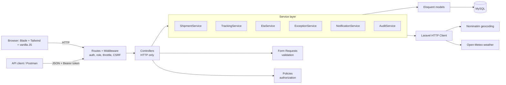

# Architecture

## Layers and responsibilities

| Layer | Location | Responsibility |
|-------|----------|----------------|
| Routes + middleware | `routes/*.php`, `app/Http/Middleware` | URL map, `auth`/`auth:sanctum`, `role:*`, throttling |
| Controllers | `app/Http/Controllers/{Web,Api}` | Translate HTTP to service calls and back. No business rules. |
| Form requests | `app/Http/Requests` | Input validation shared by web and API |
| Policies | `app/Policies` | Who may view/update/delete a shipment, report exceptions |
| Services | `app/Services` | Business rules, DB transactions, audit and notifications |
| Models / enums | `app/Models`, `app/Enums` | Persistence, relations, status maps |
| Views | `resources/views` | Blade templates; JS uses Fetch API for charts, geocoding and weather |

## Key flows

**Add a tracking event** (`POST /shipments/{id}/tracking` or the API twin)
1. Middleware: authenticated + role `admin|operator` (web) / policy `addTracking` (both).
2. `StoreTrackingEventRequest` validates type, status, time, coordinates.
3. `TrackingService::record` opens a transaction and locks the shipment row, then:
   rejects terminal shipments, future times and times before the latest event;
   validates the status transition against `ShipmentStatus::allowedTransitions()`;
   inserts a new `tracking_events` row (history is never overwritten);
   updates `shipments.status` / `actual_arrival_at` / `estimated_arrival_at`;
   calls `EtaService::evaluate` (delay flag, severity, notification);
   writes audit logs and notifies stakeholders.
4. Failures throw `ValidationException`: HTTP 422 for API, redirect-with-errors for web, nothing is saved.

**Delay detection**: `EtaService::calculate` is a pure function returning a `DelayResult` (with an explanation string shown in the UI). `evaluate` persists it and notifies only when the delay appears or its severity changes. The hourly command `cargotrace:evaluate-delays` covers shipments that become late simply because time passed.

**Authorization**: customers are limited by `Shipment::scopeVisibleTo` (list queries) and `ShipmentPolicy::view` (single records). Staff-only and admin-only areas use `role:` middleware. API and web share the same policies, so the rules cannot drift apart.

**Errors (API)**: `bootstrap/app.php` renders every `/api/*` error as `{"message": ...}` (plus `errors` for validation). Unexpected exceptions return a generic 500 message and are only logged.

## Technology choices

* **Blade + Tailwind + vanilla JS**: server-rendered pages, no SPA framework required; JS only where it adds value (charts, map, geocoding, weather).
* **Sanctum** for API tokens; session auth for the web UI.
* **Single `settings` table** instead of config-file edits so admins can change delay thresholds at runtime.
* **Open-Meteo / Nominatim** require no API key; optional keys are read from environment variables only.
