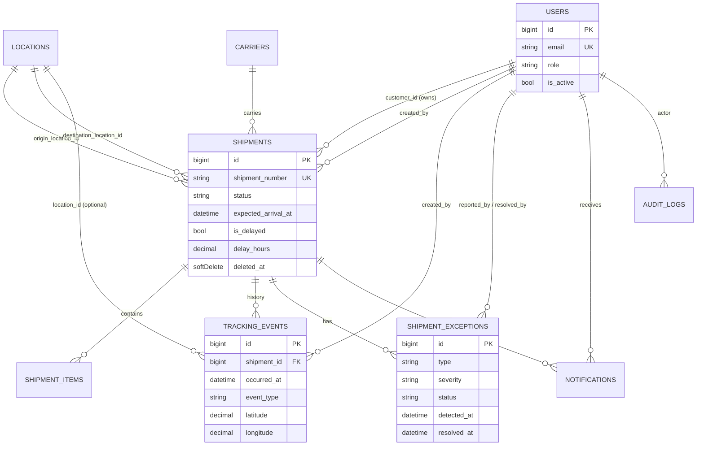

# Entity relationship diagram

## Cardinality and why

| Relationship | Cardinality | Reason |
|--------------|-------------|--------|
| user (customer) → shipments | 1 : N | A customer books many shipments; a shipment belongs to exactly one customer. This is also the ownership rule behind customer authorization (`customer_id = auth user`). |
| carrier → shipments | 1 : N | One carrier moves many shipments; a shipment uses one carrier in this MVP (multi-leg routing is out of scope). |
| location → shipments (origin, destination) | 1 : N, twice | Two separate foreign keys to the same table; a location can be the origin of some shipments and the destination of others. |
| shipment → items | 1 : N | A shipment contains many cargo lines. Items are deleted with the shipment (cascade). |
| shipment → tracking events | 1 : N | **hasMany** because history is append-only; a new status adds a row, it never overwrites the previous one. |
| shipment → exceptions | 1 : N | A shipment can face several incidents over its journey, each with its own lifecycle. |
| tracking event → location | N : 0..1 | An event can reference a known location or only raw coordinates (or neither, e.g. a note). |
| user → notifications | 1 : N | In-app inbox per user; `shipment_id` is optional context. |
| user → audit logs | 1 : N (nullable) | Actor of each change; `SET NULL` when a user is removed so history survives. |

## Design decisions

* **Status lives on `shipments`, history in `tracking_events`.** The column makes filtering and dashboards cheap; the events table is the audit-friendly source of truth. `TrackingService` is the only writer of the status column.
* **Delay fields are stored (`is_delayed`, `delay_hours`, `delay_severity`)** but derived by `EtaService`, so list filters, sorting and charts do not recalculate on every request. They are re-evaluated on every tracking event, shipment update and by an hourly command.
* **Soft delete only on `shipments`.** Deleting a shipment must not destroy its history or break audit references; other tables do not need it.
* **Polymorphism avoided in `audit_logs`**: `entity_type` + `entity_id` is a plain string/id pair. It is intentionally not a foreign key so logs outlive the entities they describe.
* **Indexes**: `shipments(status)`, `shipments(is_delayed)`, `shipments(expected_arrival_at)`, `shipments(customer_id, status)`, `tracking_events(shipment_id, occurred_at)`, `shipment_exceptions(status)`, `notifications(user_id, read_at)` support the dashboard, filters, timeline and inbox queries.
* **Unique constraints**: `users.email`, `carriers.code`, `locations.code`, `shipments.shipment_number`.
* **Foreign keys** use `restrict` where deleting the parent would orphan business data (customer, carrier, locations), `cascade` for owned child rows (items, events, exceptions, notifications), and `set null` for "who did it" references.
* **Coordinates** are `decimal(10,7)` everywhere, so storage is consistent between locations and events.
